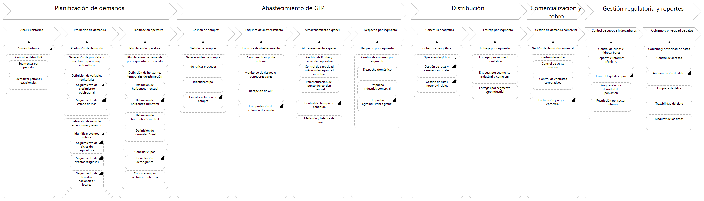

# Mapa de capacidades

Capacidades de negocio de Lojagas que el sistema de predicción apoya. Es un modelo de la organización, no del sistema: describe lo que hace la empresa, no lo que ejecuta el software. Las acciones del sistema están en la [vista lógica](../02-vista-logica/README.md).

Fuente editable: Canva.
