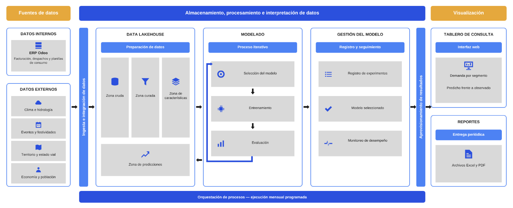

# Vista lógica (diseño arquitectónico)

Componentes del sistema y sus relaciones: fuentes internas y externas; el Data Lakehouse con sus zonas Raw, Curated, Feature y Predicciones; el motor de ML (entrenamiento, evaluación, registro de modelos y predictor); el monitoreo de desempeño con su bucle de reentrenamiento, y la interfaz de consulta de solo lectura. La correspondencia de cada componente con su contenedor y su código está en [trazabilidad.md](../trazabilidad.md).

Fuente editable: Canva. La imagen del repositorio está a 1380 px; falta exportarla a resolución completa.
