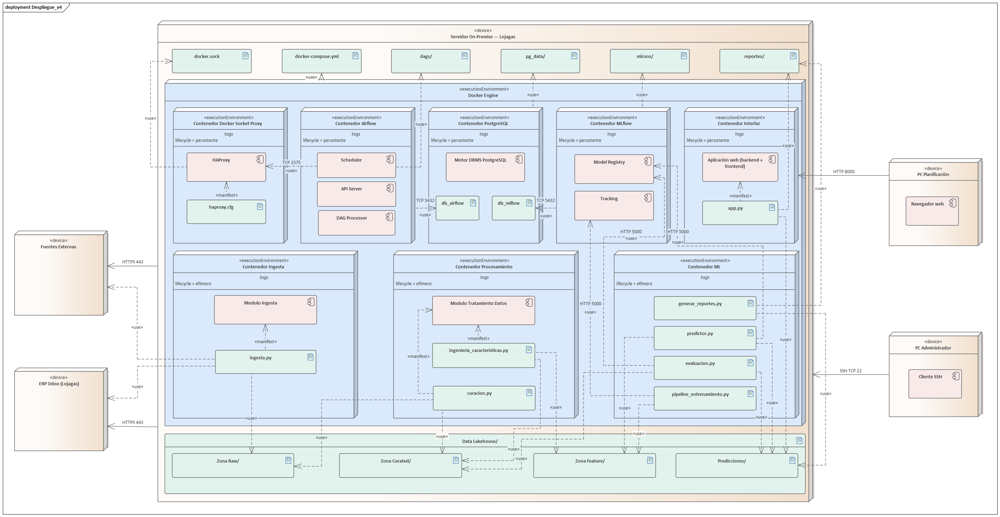

# Vista de Despliegue

Todo el sistema vive en **un único servidor on-premise de Lojagas**. Sobre él corre un Docker Engine con ocho contenedores lógicos (once reales, ver más abajo), un Data Lakehouse en disco y los directorios que el pipeline usa para trabajar. La decisión de no usar nube está en el [ADR-0001](../../adr/0001-on-premise.md) y se sostiene en los artículos 55 a 59 de la LOPDP: el dataset contiene cédulas, RUC, nombres, direcciones y coordenadas, y sacarlo del país abriría un trámite de transferencia internacional que este proyecto no necesita.

## Los ocho contenedores

Cuatro son de plataforma y están siempre encendidos:

| Contenedor | Qué hace |
|---|---|
| Docker Socket Proxy | Expone al socket de Docker solo las operaciones que DockerOperator necesita, para que Airflow no lo monte directo. [ADR-0002](../../adr/0002-docker-compose-dockeroperator-proxy.md) |
| Airflow | API Server, Scheduler y DAG Processor, cada uno en su propio contenedor, más `airflow-init`, que migra la base y termina. El diagrama los agrupa en un solo nodo para que no se vuelva ilegible. En Airflow 3 el *Webserver* ya no existe |
| PostgreSQL | Motor único con `db_airflow` y `db_mlflow`. [ADR-0003](../../adr/0003-postgresql-unico-motor.md) |
| MLflow | Tracking y Model Registry, con proxy de artefactos. [ADR-0004](../../adr/0004-mlflow-proxy-artefactos.md) |

Tres son efímeros. No corren solos: Airflow los levanta con DockerOperator en cada ejecución mensual y los detiene al terminar.

| Contenedor | Entrada | Salida |
|---|---|---|
| Ingesta | ERP Odoo y fuentes externas | zona Raw |
| Procesamiento | zona Raw | zonas Curated y Feature |
| ML | zona Feature | zona Predicciones, `reportes/` y MLflow |

El octavo es el **Contenedor Interfaz**, y es el único aplicativo que permanece encendido. Sirve el tablero de consulta y no hace nada más: no escribe, no lanza procesos y no tiene conexión con ningún otro contenedor.

## Por qué `generar_reportes.py` vive en el contenedor de ML

Es una decisión discutible y conviene dejarla por escrito antes de que la pregunten.

Renderizar los Excel y los PDF no necesita el modelo: ese script lee la zona Predicciones y la demanda observada, y produce archivos. En rigor podría vivir en una imagen propia, mucho más liviana que la de ML, que arrastra scikit-learn, XGBoost, LightGBM, Optuna, SHAP y torch CPU.

Se mantiene en el contenedor de ML por dos razones. La primera es que predecir y reportar son el mismo paso del flujo mensual: separarlos añade una tarea al DAG y una lectura intermedia desde disco a cambio de nada que el proyecto necesite hoy. La segunda es de alcance: un cuarto Dockerfile es superficie que mantener en un TIC de dos personas.

El costo que se acepta a cambio: volver a generar el reporte de un mes pasado obliga a levantar la imagen completa de ML. Como es una operación de mantenimiento, no una acción del área de planificación, se asume. Si en algún momento la regeneración se vuelve frecuente, la salida natural es un `Contenedor Reportes` propio con un extra `reportes` en `pyproject.toml`, y la decisión tendría que quedar en un ADR.

## Cómo se entra al servidor

Hay tres caminos y cada uno llega a un sitio distinto.

**El área de planificación** abre el tablero por HTTP en el puerto 8000. Es el único acceso que tiene, y desde ahí consulta las predicciones y descarga los reportes.

La carpeta compartida por SMB que antes cumplía esa función **se retiró** al incorporarse la interfaz ([ADR-0012](../../adr/0012-acceso-sin-autenticacion-segmentacion.md)). Mantener las dos habría dejado dos vías de entrega equivalentes y permisos de red sobre un directorio que ya nadie necesita. El precio es que si el contenedor de la interfaz se cae, planificación se queda sin acceso hasta que se levante; el administrador puede entregar los archivos por otra vía mientras tanto, porque `reportes/` sigue en el servidor.

**El administrador** entra por SSH en el puerto 22. Desde ahí opera el servidor y llega por túnel a las interfaces de Airflow y de MLflow, que **no publican ningún puerto**: el túnel apunta a su IP fija en la red interna de Docker (`ssh -L 5000:172.30.0.10:5000 -L 8080:172.30.0.11:8080`). Es a propósito: son las dos consolas que pueden lanzar procesos y promover modelos. Publicarlas aunque sea en `127.0.0.1` las vuelve alcanzables desde las otras redes de Docker; eso se comprobó en la prueba de humo ([ADR-0015](../../adr/0015-segmentacion-red.md)).

**El servidor hacia afuera** sale por HTTPS a las fuentes externas y a la API del ERP Odoo. Son conexiones salientes; nada entra por ahí.

## Redes

| Red | Quién está | Para qué |
|---|---|---|
| `lojagas_net` | PostgreSQL, MLflow, Airflow y los contenedores de trabajo | Plataforma y trabajos. Subred fija `172.30.0.0/24` |
| `proxy_net` (interna) | Scheduler y proxy del socket | Solo el scheduler puede hablar con el proxy |
| `interfaz_net` | Interfaz | Sin ruta hacia nada más |

Ningún servicio de `lojagas_net` publica puertos en el servidor. En desarrollo, `compose.dev.yml` publica MLflow y Airflow en `127.0.0.1` porque Docker Desktop no deja llegar a las IP de los contenedores; ese archivo nunca se usa en el servidor.

## El tablero no tiene autenticación

El control de acceso se resuelve en la capa de red, no en la aplicación:

- El contenedor publica su puerto solo sobre la dirección interna del servidor, nunca sobre `0.0.0.0`.
- El cortafuegos del servidor acepta ese puerto únicamente desde la subred del área de planificación.
- El router perimetral no lo reenvía. El tablero no es alcanzable desde fuera de la red de Lojagas.
- El contenedor corre en su propia red Docker, sin ruta hacia PostgreSQL, MLflow ni el socket de Docker.

**Esto se sostiene sobre una condición.** Ni el tablero ni los reportes exponen información a nivel de cliente: todo sale agregado por segmento y por mes, y el contenedor no monta las zonas Raw, Curated ni Feature. El día que Lojagas pida un reporte desagregado por cliente, esta decisión deja de ser defendible y hay que reemplazar el ADR-0012 por uno con autenticación.

Las tres primeras condiciones se verifican en la demostración: dónde está publicado el puerto, qué dice la regla del cortafuegos y qué responde el router.

## Qué comprobar antes de dar el despliegue por bueno

1. `docker compose ps` muestra encendidos PostgreSQL, MLflow, el proxy, los tres contenedores de Airflow y la interfaz; `airflow-init` terminado con código 0, y ninguno de los tres efímeros.
2. El DAG `prueba_humo` termina en `success`: Airflow lanza un contenedor de trabajo, este escribe y lee en el Lakehouse, alcanza MLflow y no ve el proxy.
3. `curl` al puerto del tablero funciona desde un equipo de planificación y falla desde fuera de esa subred.
4. Airflow y MLflow no responden en la IP del servidor; solo por túnel SSH.
5. Desde el contenedor de la interfaz, MLflow, Airflow, PostgreSQL y el proxy son inalcanzables **por IP**, no solo por nombre. Que no resuelva los nombres no alcanza: la prueba de humo mostró que un servicio con puerto publicado se alcanzaba por IP aunque el nombre no resolviera.
6. Dentro del contenedor de la interfaz, `predicciones/` y `reportes/` están montados en solo lectura y las demás zonas no existen.
